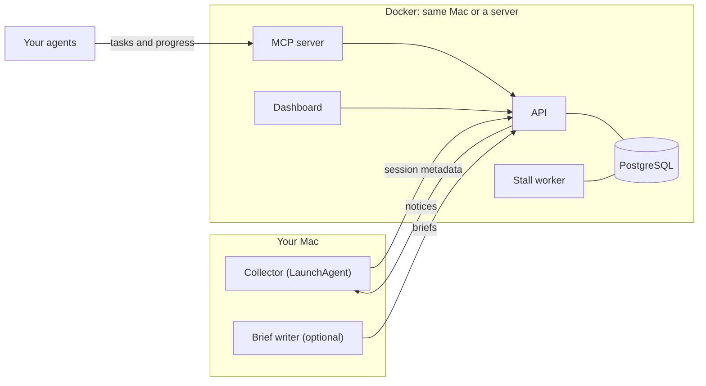

# T3 Lighthouse

Lighthouse watches your coding agents and tells you when a project stops moving.

[](https://github.com/dpreil-ydlp/t3-lighthouse/actions/workflows/ci.yml)
[](LICENSE)

```sh
curl -fsSL https://raw.githubusercontent.com/dpreil-ydlp/t3-lighthouse/main/install.sh | bash
```

You need Docker with Compose v2. The script installs into `~/t3-lighthouse`, starts the containers, and ends by printing the dashboard address and the token you sign in with. A fresh install took under a minute on an arm64 Linux machine with a fast connection. Read [install.sh](install.sh) first if you like; it is short.


Want to look around before pointing it at your own work? Add the demo projects:

```sh
curl -fsSL https://raw.githubusercontent.com/dpreil-ydlp/t3-lighthouse/main/install.sh | bash -s -- --demo
```

## What you get

**Every project on one screen.** Lighthouse finds projects from the folders your agents work in and sorts them by when something last happened: working now, earlier today, this week, gone quiet.


**A brief for each project.** What it is, what is done, what is left, and which of the remaining items are waiting on you rather than an agent. An optional job on your Mac writes it with Claude ([what it sends](#project-briefs)).


**Stall alerts.** An agent registers a task and reports progress. If the progress stops for longer than the task allows, Lighthouse opens an incident and the collector puts a notification on your Mac. Nobody answers within 10 minutes and it escalates.


**A list you can scan.** The projects table puts the next thing each project needs from you next to how much agent work is left.


**An MCP server for your agents.** Agents list projects, read briefs, create tasks, and report progress over MCP. See [Connect an agent](#connect-an-agent).

Lighthouse only watches and sends notices. It never starts, stops, or steers an agent. It works with Claude Code and Codex on their own; T3 Code support is optional.

## How it works



The collector on your Mac reads Claude Code and Codex session files and notices when the ChatGPT, Codex, and Claude desktop apps write to their data folders. It sends metadata, never message text, to the API. The worker checks every running task against its deadline and opens incidents. The dashboard and the MCP server both talk to the API.

The server side can run on the same Mac or on another machine on your private network.

## The Mac collector

On macOS the installer asks whether to set up the collector, and only installs it if you say yes. To decide up front, pass `--with-collector` or `--no-collector`. When there is no terminal to ask in, the answer is no.

The collector needs Python 3.11 or later. The `python3` that ships with macOS is older; `brew install python@3.12` fixes that. Add the collector later with:

```sh
~/t3-lighthouse/bin/lighthouse collector
```

If the server runs on another machine, install only the collector on the Mac. Copy the agent token from the server (`lighthouse agent-token` prints it) into a file, then:

```sh
curl -fsSL https://raw.githubusercontent.com/dpreil-ydlp/t3-lighthouse/main/install.sh \
  | bash -s -- --collector-only --api-url http://SERVER:51821 --agent-token-file ./agent-token
```

## Connect an agent

Point the agent's MCP client at `http://127.0.0.1:51822/mcp/` and send the agent token as `Authorization: Bearer <token>`. `lighthouse agent-token` prints it. Keep the trailing slash: `/mcp` answers with a redirect, and some clients do not follow it.

The tools let an agent list projects, read a project's brief, create tasks, report progress, register itself as a project's controller, register parent threads, and acknowledge incidents. `review_task` is for the owner only: it needs the owner token, and the API rejects agent tokens.

The same token works with the HTTP API on port 51821. If the installer picked other ports because these were taken, they are in `~/t3-lighthouse/.env`.

To check the MCP server from the command line, `lighthouse/mcp_probe.py` lists projects or calls one tool:

```sh
cd ~/t3-lighthouse && docker compose exec -T mcp python -m lighthouse.mcp_probe \
  --endpoint http://127.0.0.1:8000/mcp/ --token-file /run/secrets/agent-token list_projects
```

## Everyday commands

The installer puts a `lighthouse` command in `~/t3-lighthouse/bin` (and links it into `~/.local/bin` when that folder is on your `PATH`).

| Command | What it does |
| --- | --- |
| `lighthouse status` | Container health and the dashboard address |
| `lighthouse token` | Print the owner token for signing in |
| `lighthouse agent-token` | Print the agent token for MCP clients |
| `lighthouse up` / `down` | Start or stop; data is kept |
| `lighthouse logs [service]` | Follow the logs |
| `lighthouse demo` / `demo remove` | Load or remove the demo projects |
| `lighthouse update` | Download the latest version, pull new images, restart |
| `lighthouse uninstall` | Remove this install (asks first; `--yes` skips the question) |

Running the install one-liner again does not reinstall. It starts the existing install if it is stopped and prints the address and token again. The same one-liner with `bash -s -- --update` or `bash -s -- --uninstall` updates or removes it.

Database migrations run on every start, so an update needs no manual step.

Uninstall removes the containers, the database volume, the Lighthouse images, and the install folder (`~/t3-lighthouse`). On a Mac it also removes the collector, if this install set it up: the `ai.lighthouse.collector` LaunchAgent and its token, state, and log in `~/.config/lighthouse`. It keeps, and lists in its output:

- the `postgres` image, if it was on the machine before the install;
- a collector LaunchAgent that runs from another folder, and its files;
- the `ai.lighthouse.briefs` LaunchAgent and the T3 token in `~/.config/lighthouse/secrets`, which you set up by hand;
- anything else in `~/.config/lighthouse`.

If Docker is not running, uninstall stops before deleting anything, because the database would otherwise be left behind in a Docker volume. Start Docker and run it again.

## Configuration

The installer writes `~/t3-lighthouse/.env`. Edit it and run `lighthouse up` to apply.

| Variable | Default | Purpose |
| --- | --- | --- |
| `LIGHTHOUSE_BIND_ADDRESS` | `127.0.0.1` | Host address for all published ports |
| `LIGHTHOUSE_API_PORT` | `51821` | HTTP API |
| `LIGHTHOUSE_MCP_PORT` | `51822` | MCP server, path `/mcp/` |
| `LIGHTHOUSE_DASHBOARD_PORT` | `51823` | Dashboard |
| `LIGHTHOUSE_SECRETS_DIR` | `./secrets` | Secret files mounted into the containers |
| `COMPOSE_PROJECT_NAME` | `t3-lighthouse` | Docker Compose project name. An install outside `~/t3-lighthouse` gets its own name, such as `t3-lighthouse-lab-123456789` |
| `LIGHTHOUSE_IMAGE_PREFIX` | `ghcr.io/dpreil-ydlp/t3-lighthouse` | Where to pull the images from; the service name is appended, as in `<prefix>-api` |
| `LIGHTHOUSE_IMAGE_TAG` | `latest` | Image tag to pull; `sha-<commit>` pins a build |
| `LIGHTHOUSE_BUILD` | `0` | `1` builds the images from this checkout instead of pulling |

The installer keeps the default ports when they are free and otherwise takes the next free ones. It never uses port 3000. To choose them yourself, set them for `bash` on the first install:

```sh
curl -fsSL https://raw.githubusercontent.com/dpreil-ydlp/t3-lighthouse/main/install.sh | LIGHTHOUSE_DASHBOARD_PORT=52823 LIGHTHOUSE_API_PORT=52821 LIGHTHOUSE_MCP_PORT=52822 bash
```

The same goes for `LIGHTHOUSE_HOME` (the install folder), `LIGHTHOUSE_REF` (a branch or tag other than `main`), `LIGHTHOUSE_REPO` (a fork to download from, as `owner/repo`; `lighthouse update` keeps using it), and `COMPOSE_PROJECT_NAME`. The installer refuses a project name that another install already uses.

Keep the bind address on localhost or a private network such as Tailscale. See [Security](#security).

<details>
<summary><b>Settings inside the containers and on the Mac</b></summary>

These are read inside the containers. Set them under `environment:` in `docker-compose.yml` to change them:

| Variable | Default | Purpose |
| --- | --- | --- |
| `WORKER_INTERVAL_SECONDS` | `2` | Seconds between worker passes |
| `LIGHTHOUSE_DERIVE_SUBAGENT_TASKS` | `1` | API: set to `0` to ignore T3 subagent reports |
| `T3_DERIVED_SECOND_KICK_SECONDS` | `1800` | Worker: wait before the second notice for a silent T3 subagent |

The Mac scripts read these from the environment:

| Variable | Default | Used by |
| --- | --- | --- |
| `LIGHTHOUSE_API_URL` | `http://127.0.0.1:51821` | `briefs.py` |
| `LIGHTHOUSE_CONFIG_DIR` | `~/.config/lighthouse` | `briefs.py` state and work files; `briefs.py` refuses to write outside it |
| `LIGHTHOUSE_AGENT_TOKEN_FILE` | `~/.config/lighthouse/secrets/agent-token` | `briefs.py` |
| `LIGHTHOUSE_CLAUDE_BIN` | `~/.local/bin/claude` | `briefs.py` |
| `LIGHTHOUSE_DERIVE_SUBAGENT_TASKS` | `1` | `collector.py`: set to `0` to stop reading T3 subagents |
| `T3_MCP_URL` | `http://127.0.0.1:3773/mcp` | T3 notices |
| `T3_MCP_TOKEN_FILE` | `~/.config/lighthouse/secrets/t3-mcp-token` | T3 notices |
| `LIGHTHOUSE_API_PORT` | `51821` | `install-mac-collector.sh` |
| `LIGHTHOUSE_PYTHON` | first Python 3.11+ on `PATH` | `install-mac-collector.sh` |

`collector.py` takes `--host`, `--token-file`, and `--interval` on the command line.

</details>

## The fine print

Lighthouse reads files on your Mac and, if you turn briefs on, sends project text to Claude. The sections below say exactly what goes where. Read them before you install the collector or the brief writer.

<details id="what-the-collector-sends">
<summary><b>What the collector sends</b></summary>

The collector sends metadata to your Lighthouse server and nowhere else. It never sends message text from your sessions.

- **Claude Code and Codex sessions** (`~/.claude/projects`, `~/.codex/sessions`): an event for each new session record with the working directory, the session ID, the record type (for example `user` or `assistant`), and the record timestamp. The message body is not read into the event.
- **Thread titles**: the session title each tool stores. For Claude Code this is the `summary` record that Claude Code writes into the session file; for Codex it is the name in `~/.codex/session_index.jsonl`.
- **Project folders**: the paths and folder names of the direct subfolders of `~/Projects` (or `~/projects`) that a session has worked in.
- **Desktop apps** (ChatGPT, Codex, and Claude): when a file in the app's data folder changes, a SHA-256 hash of the file's relative path and its modification time. File names and contents are not sent.
- **T3 Code**, if installed: project paths and names, thread and subagent IDs, titles, status, and timestamps from T3's database. See [T3 Code integration](#t3-code-integration).

It keeps its read positions in `~/.config/lighthouse/collector-state.json` and its log in `~/.config/lighthouse/collector.log`.

</details>

<details id="project-briefs">
<summary><b>Project briefs: what is sent to Claude</b></summary>

`collector/briefs.py` writes the short brief shown on each project card. It runs on the Mac and sends project text to Anthropic's Claude through your Claude Code CLI. It is off until you schedule it.

Which projects: every active project in Lighthouse whose folder exists on the Mac. You do not pick them one by one. A project is sent on its first run and again whenever it has new session text or commits. To leave a project out, hide or archive it in the dashboard, or run the job by hand with `--project <slug>`.

What each run sends for a project:

- user and assistant message text from Claude Code and Codex sessions that worked in the project folder (tool calls, tool output, and thinking are skipped), newest first;
- the dates and subject lines of up to 40 new Git commits;
- on the first run for a project, up to 8,000 characters each of `README*`, `CLAUDE.md`, `AGENTS.md`, and `memory.md` from the project folder;
- the previous brief.

The total is capped at about 40,000 characters per project, with at most 12 model calls per run.

Before sending, the job removes text that looks like a credential: bearer tokens, common API key formats, private keys, `password=`-style fields, and long hex or base64 strings. This uses regular expressions and is best effort. It will miss secrets in other formats, and it does not remove personal data.

The model is fixed to `claude-haiku-5-5`. The job runs the `claude` CLI with your Claude Code login, so usage counts against your Claude Code account. It drops `ANTHROPIC_API_KEY` and other provider settings from the environment.

To list the projects it would send, without calling Claude, run `python3 collector/briefs.py --dry-run` from `~/t3-lighthouse`. To schedule it every 30 minutes, fill in the placeholders in `collector/scripts/ai.lighthouse.briefs.plist` and load it:

```sh
cd ~/t3-lighthouse
sed -e "s|__PYTHON__|$(command -v python3)|" -e "s|__REPO__|$PWD|" -e "s|__HOME__|$HOME|g" \
  collector/scripts/ai.lighthouse.briefs.plist > ~/Library/LaunchAgents/ai.lighthouse.briefs.plist
launchctl bootstrap "gui/$(id -u)" ~/Library/LaunchAgents/ai.lighthouse.briefs.plist
```

The Claude Code CLI is only needed for this job.

</details>

<details id="t3-code-integration">
<summary><b>T3 Code integration reads an internal database</b></summary>

This part is optional. If T3 Code is installed, the collector reads T3's local SQLite database to link sessions to T3 threads and subagents. Lighthouse can also post stall notices into a T3 thread through T3's MCP server.

T3 does not publish that database as an API. Lighthouse opens it read-only and never writes to it, but the schema is internal to T3 and can change in any T3 update. When that happens, the T3 part of the collector can stop working until Lighthouse is updated. The rest of Lighthouse keeps running.

</details>

<details id="notices">
<summary><b>Notices and the webhook channel</b></summary>

When a task misses its deadline, the worker opens an incident. By default the Mac collector then shows a macOS notification, through `terminal-notifier` if it is installed and `osascript` otherwise. If nobody acknowledges the incident before the deadline (10 minutes by default), it escalates and the collector shows a second notification.

The owner can switch a project's notices to a webhook with `PUT /api/v1/controllers/{controller_id}/channel` and a body of `{"channel": "t3_webhook", "t3_webhook_url": "https://..."}`. The worker then posts each notice as JSON to that HTTPS URL, with an HMAC-SHA256 signature of the body in the `X-T3-Signature` header, keyed with `secrets/t3-webhook-hmac`. The name comes from its first use with T3 Code, but any HTTPS receiver works.

</details>

<details id="security">
<summary><b>Security</b></summary>

Keep the bind address on localhost or a private network such as Tailscale. The API uses bearer tokens, but it was not built to face the open internet. The dashboard session cookie is not marked `Secure` because there is no TLS in front of it.

The installer writes the secrets with mode 0600 into `~/t3-lighthouse/secrets` (mode 0700) and prints the owner token once, in your own terminal, so you can sign in. `lighthouse token` prints it again.

To report a vulnerability, see [SECURITY.md](SECURITY.md).

</details>

<details>
<summary><b>Example: make a stall alert fire</b></summary>

Stall monitoring works per task. A task stalls when it is `running` and has had no meaningful progress for longer than its `meaningful_progress_seconds` threshold (30 minutes if unset). This example sets a 60-second threshold with the HTTP API. The MCP tools `create_task` and `report_progress` take the same fields.

```sh
TOKEN=$(lighthouse agent-token)
API=http://127.0.0.1:51821
post() {
  curl -fsS -H "Authorization: Bearer $TOKEN" -H "Content-Type: application/json" \
    -H "Idempotency-Key: $1" -d "$3" "$API$2"
}
id() { python3 -c "import json,sys; print(json.load(sys.stdin)['$1']['id'])"; }

PROJECT=$(post demo-project-1 /api/v1/projects '{"name": "Stall demo"}' | id project)
TASK=$(post demo-task-1 /api/v1/projects/$PROJECT/tasks \
  '{"title": "Demo task", "thresholds": {"meaningful_progress_seconds": 60}}' | id task)
post demo-progress-1 /api/v1/events "{\"task_id\": \"$TASK\", \"status\": \"running\",
  \"meaningful\": true, \"summary\": \"Started the demo task\",
  \"source_event_id\": \"demo-progress-1\", \"observed_at\": \"$(date -u +%Y-%m-%dT%H:%M:%SZ)\"}"
```

Every write needs an `Idempotency-Key` header. A repeated key with the same body returns the first response, so change the keys (and `source_event_id`) to run the example again.

Wait about 70 seconds, then list incidents:

```sh
curl -fsS -H "Authorization: Bearer $TOKEN" $API/api/v1/incidents | python3 -m json.tool
```

You should see an incident with `"kind": "stall"`, `"state": "open"`, `"task_title": "Demo task"`, and `"reason": "No meaningful progress within the task threshold"`. It also appears on the dashboard's Incidents page. Another meaningful progress event for the task resolves it.

</details>

<details>
<summary><b>The demo projects</b></summary>

`lighthouse demo` (or `--demo` at install) adds five made-up projects: a recipe site, a habit-tracker app, a docs site, a command-line tool, and a Raspberry Pi weather display. They come with sessions, progress reports, briefs, one resolved incident, and a task that has stopped reporting, which the worker turns into an open stall incident within seconds. Every name, folder, and number in them is invented. The screenshots above are of this data.

`lighthouse demo remove` deletes them and nothing else. Loading again replaces them with fresh timestamps.

</details>

<details>
<summary><b>Install by hand</b></summary>

What the installer does, step by step, from a clone of this repository. Use this if you want to see each step or run the server somewhere the script does not fit.

1. Create the configuration and secrets.

   ```sh
   cp .env.example .env
   mkdir -m 700 secrets
   openssl rand -hex 32 > secrets/db-password
   openssl rand -hex 32 > secrets/dashboard-session-key
   openssl rand -hex 32 > secrets/t3-webhook-hmac
   chmod 600 secrets/*
   ```

   `t3-webhook-hmac` signs notices for the optional webhook channel described under [Notices](#notices). Compose mounts it into the worker, so create it even if you never use that channel.

2. Start the database and the API. The `migrate` service applies the database migrations before the API starts, and on every later start.

   ```sh
   docker compose up -d db api
   ```

   To build the images from this checkout instead of pulling them, add `-f docker-compose.yml -f docker-compose.build.yml` to every `docker compose` command and `--build` to `up`.

3. Create the owner login and the agent credential. Each command writes a new token file into the secrets directory and does not print the token.

   ```sh
   docker compose exec -T api admin-entrypoint bootstrap --name owner --token-file /host-secrets/owner-token
   docker compose exec -T api admin-entrypoint issue-principal --name agent --kind agent --token-file /host-secrets/agent-token
   ```

   On Linux with rootful Docker, the API container writes these files as root. Read them with `sudo cat`, or `sudo chown` them to your user, in the steps below.

4. Start the rest.

   ```sh
   docker compose up -d
   curl -fsS http://127.0.0.1:51821/healthz
   ```

   Open the dashboard at `http://127.0.0.1:51823` and log in with the contents of `secrets/owner-token`.

5. Install the collector on the Mac. Put the agent token at `~/.config/lighthouse/secrets/agent-token`, then run:

   ```sh
   mkdir -p -m 700 ~/.config/lighthouse/secrets
   cp secrets/agent-token ~/.config/lighthouse/secrets/agent-token
   chmod 600 ~/.config/lighthouse/secrets/agent-token
   scripts/install-mac-collector.sh --host 127.0.0.1 --port 51821
   ```

   This writes and loads a LaunchAgent named `ai.lighthouse.collector`. If the server is another machine, copy `secrets/agent-token` from the server instead, for example with `scp`, and use the server's address for `--host`.

An install made by hand before the `migrate` service existed is picked up as it is: on its first run, `migrate` records the migrations the database already has and applies only the missing ones.

</details>

<details>
<summary><b>Development and tests</b></summary>

| Path | What it is |
| --- | --- |
| `lighthouse/` | FastAPI HTTP API, MCP server, stall worker, migration runner, demo data, and admin CLI |
| `db/migrations/` | PostgreSQL schema |
| `dashboard/` | Next.js dashboard |
| `collector/collector.py` | Mac collector for session files and app activity |
| `collector/briefs.py` | Optional job that writes project briefs with the Claude Code CLI |
| `collector/t3_read.py`, `collector/t3_mcp.py` | Optional T3 Code integration |
| `install.sh`, `bin/lighthouse` | Installer and management command |
| `docker-compose.yml` | PostgreSQL, migrations, API, MCP server, worker, and dashboard |

Pushes build multi-arch images (`linux/amd64`, `linux/arm64`) with [GitHub Actions](.github/workflows/images.yml) and publish them to `ghcr.io/dpreil-ydlp/t3-lighthouse-{api,mcp,worker,dashboard}`.

The API tests need PostgreSQL at host `db` and create and drop their own `lighthouse_test` database. They refuse to run against an existing one. Run them inside the API container:

```sh
docker compose exec -T api run-tests
```

Collector tests run without a database. They need pytest (`python3 -m pip install pytest`):

```sh
python3 -m pytest collector/tests
```

Dashboard (Node.js 26 or later):

```sh
cd dashboard && npm ci && npm run build && node tests/test_brief_render.cjs && node tests/test_session_key.cjs
```

The installer tests stub Docker, `launchctl`, and `curl`, and run in a throwaway home folder:

```sh
bash tests/installer/run.sh
```

</details>

## License

MIT. See [LICENSE](LICENSE).
