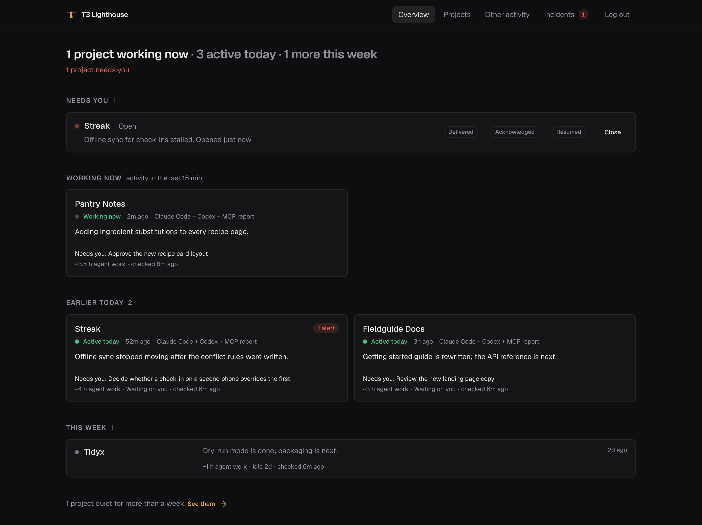
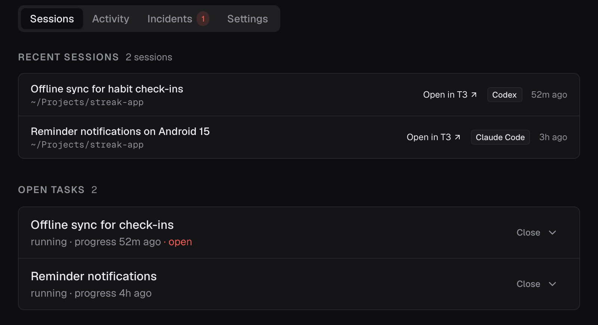
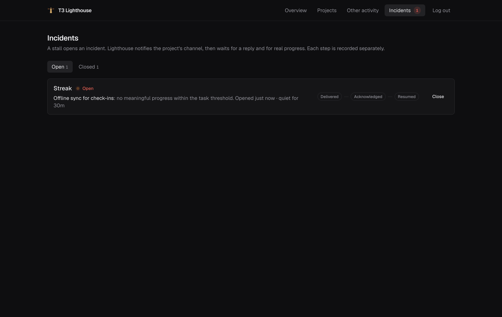
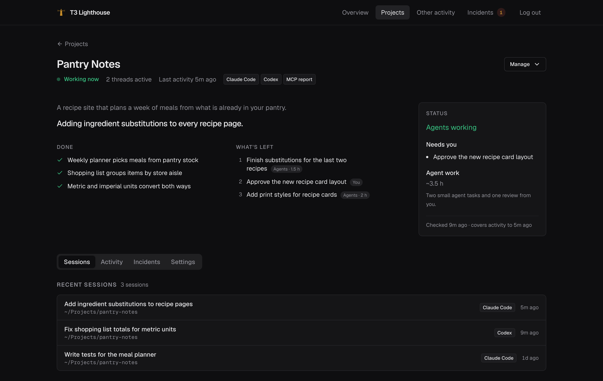
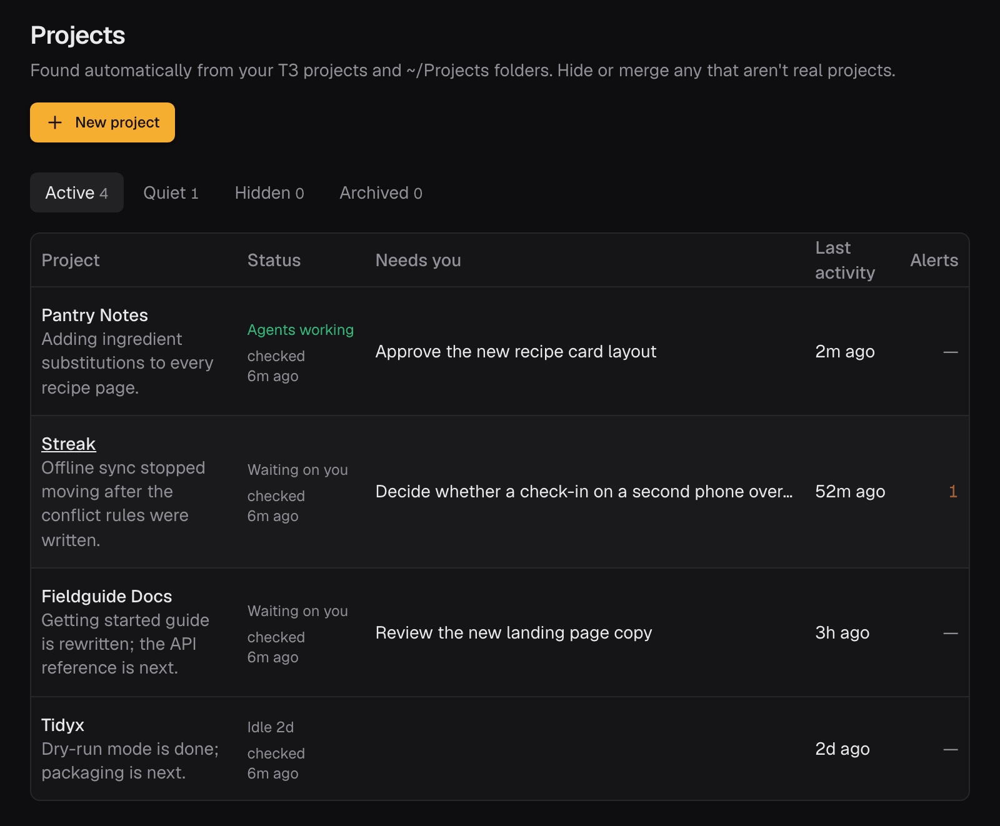
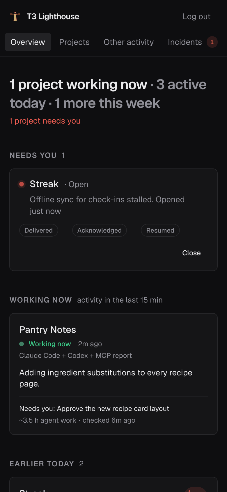

# T3 Lighthouse

Lighthouse is built for people who run coding agents in T3 Code. It also works with plain Claude Code and Codex, without T3.

It shows every project your agents touch on one dashboard and tells you when agent work stops. Exactly two things raise an alert:

- **A T3 subagent goes silent.** T3 shows the subagent as running, but it has finished no command, tool call, or message for 30 minutes. Lighthouse posts a notice into the parent T3 thread, and a second one 30 minutes later if nothing changed. The agent needs no setup.
- **A registered task stops reporting.** An agent (Claude Code, Codex, or one inside T3) registered a task over MCP and has reported no progress for longer than the limit it set, 30 minutes unless it chose another. Your Mac shows a notification, and a second one if nobody acknowledges it within 10 minutes.

Nothing else alerts. A session that just goes quiet moves its project to "gone quiet" on the dashboard. Lighthouse watches and sends notices; it never starts, stops, or steers an agent.

[](https://github.com/dpreil-ydlp/t3-lighthouse/actions/workflows/ci.yml)
[](LICENSE)

[Requirements](#requirements) · [Install](#install) · [First alert](#your-first-alert-in-about-a-minute) · [Connect agents](#connect-claude-code-and-codex) · [Privacy and limits](#privacy-and-limits) · [Docs](docs/README.md)





Screenshots use demo data. Project briefs require the optional Claude job.

<details>
<summary>More screenshots</summary>









</details>

## Requirements

- Docker with Compose v2, on the Mac or another machine on your private network, for the server: PostgreSQL, an API, an MCP server, a stall worker, and the dashboard.
- macOS for the collector, which reads your sessions and shows notifications. It needs Python 3.11 or later; the `python3` that ships with macOS is older, so run `brew install python@3.12` first.
- T3 Code, for subagent alerts and links into T3. Without it, everything else works.

Tested on macOS 26 (Apple silicon) with Docker Desktop and T3 Code, and on Fedora Linux 44 (arm64) with Docker Engine.

## What it reads and sends

The collector sends session metadata (folders, IDs, titles, times), never message text, and T3 Code's project and thread list, read in place. It all goes to your Lighthouse server and nowhere else, unless you turn on project briefs, which send project text to Claude. Details: [Privacy and limits](#privacy-and-limits).

## Install

```sh
curl -fsSL https://raw.githubusercontent.com/dpreil-ydlp/t3-lighthouse/main/install.sh | bash
```

It installs into `~/t3-lighthouse`, starts the containers, and prints the dashboard address and your sign-in token. [install.sh](install.sh) is short.

On a Mac it then asks whether to install the collector. Say yes. If T3 Code is installed, the installer also connects Lighthouse to T3 so notices can go into T3 threads. It gets a five-minute pairing code from T3's own `t3` command and approves Lighthouse with it; there is nothing to click. [How the T3 connection works](docs/t3-code.md).

When it worked, the output ends with:

```text
T3 Code found: the collector links your T3 projects, threads, and subagents.
==> Connecting to T3 Code, so stall notices for T3 subagents go into their parent thread
Connected to T3 Code. ... The token expires 2026-11-28 11:08 UTC; the collector renews it before then.
```

Open the dashboard. Within a minute it lists your T3 projects and the `~/Projects` folders your agents worked in; a project's page has "Open in T3" links to its threads.

To look around with made-up projects first, add `--demo`: `curl ... | bash -s -- --demo`.

If the server runs on another machine, see [Server on another machine](docs/install-by-hand.md#server-on-another-machine).

## Your first alert in about a minute

This registers a task with a 60-second limit and reports progress once, the way an agent would:

```sh
TOKEN=$(~/t3-lighthouse/bin/lighthouse agent-token)
API=http://127.0.0.1:51821
post() {
  curl -fsS -H "Authorization: Bearer $TOKEN" -H "Content-Type: application/json" \
    -H "Idempotency-Key: $1" -d "$3" "$API$2"
}
id() { python3 -c "import json,sys; print(json.load(sys.stdin)['$1']['id'])"; }

RUN=$(date +%s)
PROJECT=$(post project-$RUN /api/v1/projects '{"name": "Stall demo"}' | id project)
TASK=$(post task-$RUN /api/v1/projects/$PROJECT/tasks \
  '{"title": "Demo task", "thresholds": {"meaningful_progress_seconds": 60}}' | id task)
post progress-$RUN /api/v1/events "{\"task_id\": \"$TASK\", \"status\": \"running\",
  \"meaningful\": true, \"summary\": \"Started the demo task\",
  \"source_event_id\": \"progress-$RUN\", \"observed_at\": \"$(date -u +%Y-%m-%dT%H:%M:%SZ)\"}"
```

What success looks like, about 60 seconds later:

- with the collector installed, your Mac shows a notification titled **Lighthouse: task stalled**;
- the dashboard's Incidents page lists an open stall for "Demo task";
- `curl -fsS -H "Authorization: Bearer $TOKEN" $API/api/v1/incidents` returns it with `"kind": "stall"`.

Leave it, and 10 minutes later a second notification says **Lighthouse: incident escalated**. Close the incident on the Incidents page when you are done.

## Connect Claude Code and Codex

The MCP server is at `http://127.0.0.1:51822/mcp/` (keep the trailing slash) and takes the agent token as a bearer token. If the installer picked other ports, they are in `~/t3-lighthouse/.env`.

**Claude Code:**

```sh
claude mcp add --transport http --scope user lighthouse http://127.0.0.1:51822/mcp/ \
  --header "Authorization: Bearer $(~/t3-lighthouse/bin/lighthouse agent-token)"
```

`claude mcp list` should show `lighthouse: http://127.0.0.1:51822/mcp/ (HTTP) - ✔ Connected`.

**Codex:** Codex reads the token from an environment variable. Add the export to your shell profile so every Codex session has it:

```sh
echo 'export LIGHTHOUSE_AGENT_TOKEN=$(~/t3-lighthouse/bin/lighthouse agent-token)' >> ~/.zshrc
codex mcp add lighthouse --url http://127.0.0.1:51822/mcp/ --bearer-token-env-var LIGHTHOUSE_AGENT_TOKEN
```

`codex mcp list` should show `lighthouse` with that URL.

**Ask agents to register their work.** Put this in `CLAUDE.md` or `AGENTS.md`:

```markdown
## Lighthouse
For any task that will take more than 15 minutes, use the lighthouse MCP tools:
1. Call `list_projects` and pick the project whose folder you are working in.
2. Call `create_task` with its `project_id`, a short `title`,
   `thresholds: {"meaningful_progress_seconds": 1800}`, and a new `idempotency_key`.
3. Right away, and after each finished step, call `report_progress` with the `project_id`,
   the `task_id`, `status: "running"`, `meaningful: true`, a one-line `summary`,
   `observed_at` as the current UTC time, and a new `source_event_id` and `idempotency_key`.
4. When done, call `report_progress` the same way with `status: "complete"`.
```

The task then appears under Open tasks on the project's page, and a stall raises the alert above.

## Everyday commands

`lighthouse` is in `~/t3-lighthouse/bin`, and in `~/.local/bin` when that is on your `PATH`.

| Command | What it does |
| --- | --- |
| `lighthouse status` | Container health and the dashboard address |
| `lighthouse token` / `agent-token` | Print the owner token (sign-in) or the agent token (MCP) |
| `lighthouse up` / `down` | Start or stop; data is kept |
| `lighthouse logs [service]` | Follow the logs |
| `lighthouse demo` / `demo remove` | Load or remove the demo projects |
| `lighthouse collector` | Install the Mac collector later |
| `lighthouse t3-connect` | Connect to T3 Code again, or `--disconnect` |
| `lighthouse update` | Download the latest version and restart |
| `lighthouse uninstall` | Remove this install (asks first) |

[What uninstall removes and keeps](docs/uninstall.md) · [Configuration](docs/configuration.md) · [Install by hand](docs/install-by-hand.md) · [How it works and development](docs/development.md)

## Privacy and limits

**The collector** sends to your Lighthouse server only:

- for Claude Code and Codex sessions (`~/.claude/projects`, `~/.codex/sessions`): one event per new session record, with the working folder, session ID, record type, and timestamp, but not the message;
- session titles: Claude Code's `summary` record and the names in `~/.codex/session_index.jsonl`;
- the paths of `~/Projects` (or `~/projects`) subfolders that sessions worked in;
- for the ChatGPT, Codex, and Claude desktop apps: a SHA-256 hash of a changed file's path, and its modification time;
- from T3 Code: project paths and names, thread and subagent IDs, titles, status, and timestamps.

It keeps its state and log in `~/.config/lighthouse`, and a lock file in `~/.cache/lighthouse`.

**T3 Code's database is not a public API.** Lighthouse opens it read-only and never copies it, but its schema can change in any T3 update, and the T3 part may then stop working until Lighthouse catches up. The T3 token has T3's read and operate scopes at "approval required" access; Lighthouse uses it only to check that a subagent is still running and to post the notice. [Details](docs/t3-code.md).

**Project briefs are off by default.** The optional brief writer sends session text, commit subjects, and README-type files to Claude through your Claude Code CLI. [What it sends and how to turn it on](docs/briefs.md).

**Keep it private.** Bind to localhost or a private network such as Tailscale. The API uses bearer tokens but was not built to face the internet. Secrets live in `~/t3-lighthouse/secrets` with mode 0600. To report a vulnerability, see [SECURITY.md](SECURITY.md).

**Limits.** Alerts depend on the collector running on the Mac. Subagent alerts need T3 Code on the same Mac as the collector. Mac notifications use `terminal-notifier` if installed, otherwise `osascript`.

## License

MIT. See [LICENSE](LICENSE).
