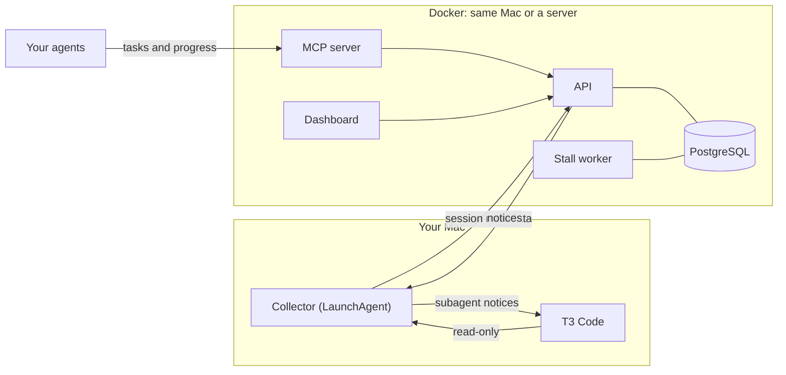

# How it works and development

[Back to the README](../README.md)

## How it works



The collector polls every 2 seconds and sends metadata to the API. The worker checks every running task against its limit and opens incidents. The collector shows the Mac notifications and posts T3 notices.

## Development and tests

| Path | What it is |
| --- | --- |
| `lighthouse/` | FastAPI HTTP API, MCP server, stall worker, migration runner, demo data, and admin CLI |
| `db/migrations/` | PostgreSQL schema |
| `dashboard/` | Next.js dashboard |
| `collector/collector.py` | Mac collector for session files and app activity |
| `collector/briefs.py` | Optional job that writes project briefs with the Claude Code CLI |
| `collector/t3_read.py`, `collector/t3_mcp.py`, `collector/t3_connect.py` | T3 Code integration: read T3's project and thread list, post notices, connect and renew the T3 token |
| `install.sh`, `bin/lighthouse` | Installer and management command |
| `docker-compose.yml` | PostgreSQL, migrations, API, MCP server, worker, and dashboard |

Pushes build multi-arch images (`linux/amd64`, `linux/arm64`) with [GitHub Actions](.github/workflows/images.yml) and publish them to `ghcr.io/dpreil-ydlp/t3-lighthouse-{api,mcp,worker,dashboard}`.

The API tests need PostgreSQL at host `db` and create and drop their own `lighthouse_test` database. They refuse to run against an existing one. Run them inside the API container:

```sh
docker compose exec -T api run-tests
```

Collector tests run without a database. They need pytest (`python3 -m pip install pytest`):

```sh
python3 -m pytest collector/tests
```

Dashboard (Node.js 26 or later):

```sh
cd dashboard && npm ci && npm run build && node tests/test_brief_render.cjs && node tests/test_session_key.cjs
```

The installer tests stub Docker, `launchctl`, and `curl`, and run in a throwaway home folder:

```sh
bash tests/installer/run.sh
```
